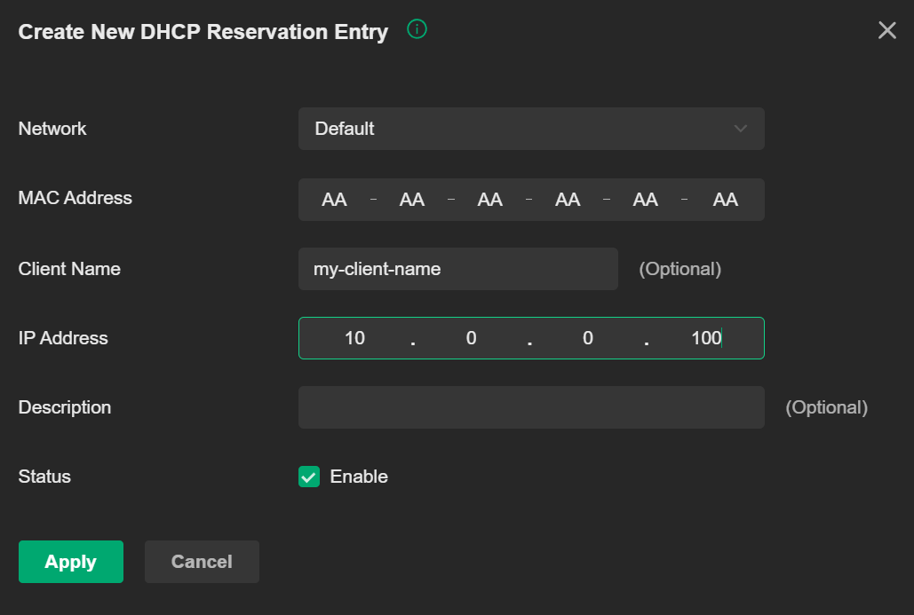

# Configuration

CoreDNS is configured using a configuration file called a [Corefile](https://coredns.io/2017/07/23/corefile-explained/) which supports [variable substitution](https://coredns.io/manual/configuration/#environment-variables) so values can be provided using environment variables.

## Corefile examples
Example corefiles are located [here](../corefile-examples)

## Omada plugin configuration syntax

| Name                      | Required | Type     | Notes                                                                                                                                                                                         |
| ------------------------- | -------- | -------- | --------------------------------------------------------------------------------------------------------------------------------------------------------------------------------------------- |
| controller_url            | ✅        | string   | address of the Omada controller. Include `https://` prefix                                                                                                                                    |
| site                      | ✅        | string   | name of the site from the Omada controller (note this is a regex pattern)                                                                                                                     |
| username                  | ✅        | string   | Omada controller username                                                                                                                                                                     |
| password                  | ✅        | string   | Omada controller password                                                                                                                                                                     |
| refresh_minutes           | ❌        | int      | How often to refresh the zones (default 1 minute)                                                                                                                                             |
| refresh_login_hours       | ❌        | int      | How often to refresh the login token (default 24 hours)                                                                                                                                       |
| resolve_clients           | ❌        | bool     | Whether to resolve client addresses (default true)                                                                                                                                            |
| resolve_devices           | ❌        | bool     | Whether to resolve device addresses (default true)                                                                                                                                            |
| resolve_dhcp_reservations | ❌        | bool     | Whether to resolve device addresses (default true)                                                                                                                                            |
| stale_record_duration     | ❌        | duration | How long to keep serving stale records for clients/devices which are no longer present in the Omada controller. Specified in Go time [duration](https://pkg.go.dev/time#ParseDuration) format |
| ignore_startup_errors     | ❌        | bool     | ignore connection/configuration errors to the omada controller on startup. Set this to true if you want coredns to startup even if unable to connect to omada (default false)                 |
| fallthrough [ZONES...]    | ❌        | []string | Whether to enable fallthrough. If fallthrough statement is present but no zone is specified then defaults to all zones, equivilent to:<br> `fallthrough .`                                                                       |
| network_domain NETWORK DOMAIN | ❌    | string   | DNS domain for a network that has no domain set on the controller. `NETWORK` is the network name or its subnet in CIDR notation. Can be repeated. See [Networks without a domain](#networks-without-a-domain) |
| default_domain            | ❌        | string   | DNS domain for any other network without a domain (default: unset, those networks are skipped)                                                                                               |

## Credentials

For this service you should create a new user in the `Admin` page of the controller with a `Viewer` role.

## Omada Site

A single Omada controller can support multiple network sites. This plugin can be configured to use multiple sites via the `site` configuration property (regex). Multiple sites can be specified using the `|` separator like this `SiteA|SiteB|SiteC` or all sites can be selected by setting it to `.*`

## Networks without a domain

Zones are built from the domain set on each LAN network in the controller, and networks without one are skipped. Some controller versions (e.g. Omada 6.3) no longer have a per-network domain setting, so `network_domain` can be used to set it in the Corefile instead:

```
network_domain Default home.arpa
network_domain 10.0.20.0/24 office.home.arpa
```

If `NETWORK` contains a `/` it is matched against the network's subnet, otherwise against its name (case-insensitive). The first matching line wins. `default_domain` covers every remaining network without a domain. A domain set on the controller always takes precedence.

## Fallthrough behaviour

The `fallthrough` option controls the behaviour for records which are not found. If fallthrough is enabled then requests for records which are not found are passed to the next plugin in the chain. If fallthrough is disabled then records which are not found are returned an `NXDOMAIN` response by the coredns_omada plugin and processing stops without being passed down the plugin chain.

The use case for using fallthrough is to use other plugins to handle queries for the same zone as `coredns_omada` such as the [file](https://coredns.io/plugins/file/) plugin.

Note: prior to the fallthrough option being implemented, the default behaviour enabled fallthrough.

## HTTPS Verification

This will depend on your network and configuration, but due to the lack of a suitable internal DNS resolution you may need to disable HTTPS verification to the controller, as even if you have a valid certificate on your controller you need a valid DNS record pointing to your controller where coredns is running.

HTTPS verification can be disabled by setting environment variable `OMADA_DISABLE_HTTPS_VERIFICATION` to `true`

An option to keep HTTPS verification enabled is to create a public DNS A record pointing to your controllers private IP address.

## Custom DNS records

It is possible to create a dummy DHCP reservation in the Omada controller to create custom DNS records.

* In the Omada controller go to `Settings` -> `Services` -> `DHCP Reservations`
* Create a new DHCP reservation:
    - Enter a dummy MAC address e.g AA-AA-AA-AA-AA-AA
    - Enter the desired IP address
    - Enter the client name
    - (If you are unable to set the client name then use the description - there is a fallback in the code for this and the options seem to vary across controller versions)
    - Example: 

Note that wildcard records are supported by setting the client name to `*.<subdomain>` e.g `*.apps`.